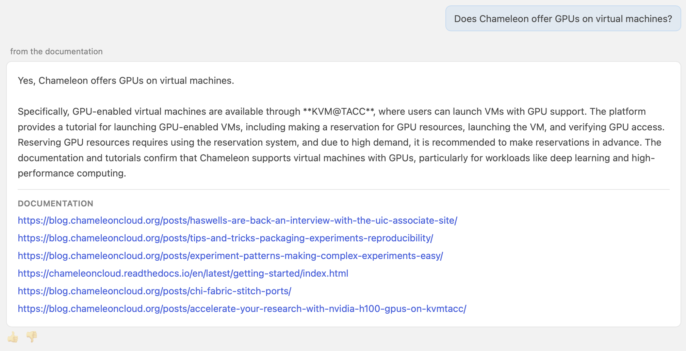

# Asking Documentation Questions

Cloud Conversations can answer your questions about Chameleon, using Chameleon's own documentation.

Type your question into the message box of any experiment. For example:

```text
Does Chameleon offer GPUs on virtual machines?
```

Answers from the documentation are marked **from the documentation**. Below each answer, the **Documentation** section links to the pages it used. We recommend opening them to confirm the details.

<figure markdown="span">
  
  <figcaption>An answer from the documentation, with its sources</figcaption>
</figure>

Answers draw on the following sources:

- [Chameleon Docs](https://chameleoncloud.readthedocs.io/en/latest/)
- [Python CHI Docs](https://python-chi.readthedocs.io/en/latest/)
- [Chameleon Blog](https://blog.chameleoncloud.org)

!!! tip

    You don't need a keypair to ask questions.
