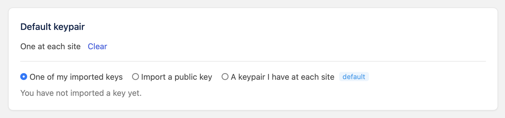
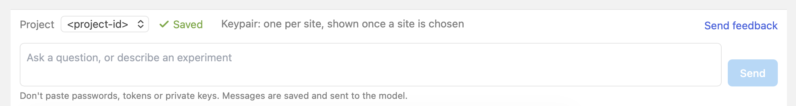
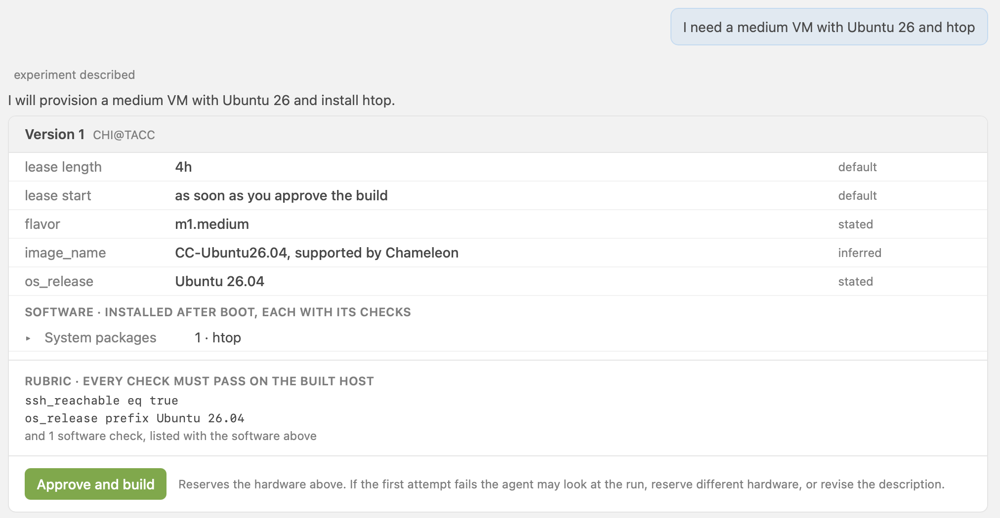
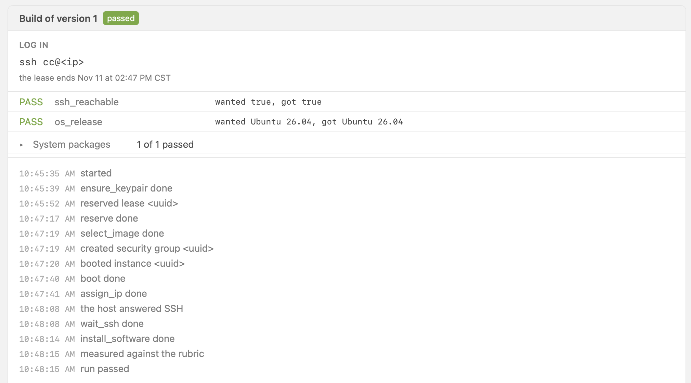
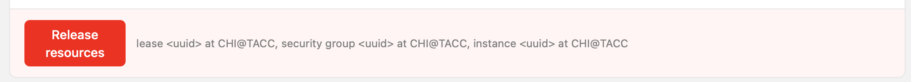

# Getting Started

**Welcome to Cloud Conversations! We're glad you're here.**

In this guide, we walk through the core steps of using Cloud Conversations: logging in, setting up a keypair, describing an experiment, building it on Chameleon, and connecting to it.

!!! attention "Before you begin"

    Make sure you have the following:

    - A **Chameleon user account**. See Chameleon's [federated authentication guide](https://chameleoncloud.readthedocs.io/en/latest/user/federation.html) to create one.
    - Membership in an **active Chameleon project**. See Chameleon's [project guide](https://chameleoncloud.readthedocs.io/en/latest/user/project.html) to create a project or join an existing one.

At the end of this guide, you'll have learned how to:

- Log in to Cloud Conversations with your Chameleon account
- Describe an experiment in plain English and review the description
- Build it on Chameleon hardware and connect to it over SSH
- Release your resources when you're done

## Step 1: log in

Head to [app.cloudconversations.org](https://app.cloudconversations.org) and click **Log in with Chameleon**. Sign in with your Chameleon account.

!!! important "Cloud Conversations is in preview"

    During the preview, an admin must approve each new account. Your first login sends the request, and the login page shows *an admin must approve this account before you can use it*. Once your account is approved, log in again.

## Step 2: set up a keypair

Cloud Conversations installs an SSH key on each instance it builds for you, so that you can log in to it. Before your first build, click **Profile** at the top of the page and go to the **Default keypair** section. You can:

- **Import a public key** by pasting the public half of an SSH key you already use
- Choose **A keypair I have at each site** if you already have keypairs at the Chameleon sites
- Pick **One of my imported keys** once you have imported one

<figure markdown="span">
  
  <figcaption>The Default keypair section of your Profile page</figcaption>
</figure>

Every new experiment uses your default keypair. You can change it for a single experiment from the **Keypair** menu below the message box.

## Step 3: describe your experiment

Click **New experiment** in the sidebar. Below the message box, the **Project** menu shows the project this experiment builds in. Its hardware is charged to that project's allocation.

<figure markdown="span">
  
  <figcaption>Pick a project below the message box</figcaption>
</figure>

Now tell Cloud Conversations what you want, in plain English. For example:

```text
I need a medium VM with Ubuntu 26 and htop
```

Cloud Conversations replies with a **description** of your experiment.

<figure markdown="span">
  
  <figcaption>The description of an experiment, ready to approve</figcaption>
</figure>

Let's go through it:

- **Requirements** come first: the site, the lease length and start, the hardware, and the image. The column on the right shows whether you stated each one, or Cloud Conversations inferred it or chose a default.
- **Software** lists the packages Cloud Conversations installs after boot. Click a group to see each package and its checks.
- The **Rubric** lists the checks your instance must pass once it's built.
- **Assumptions** lists choices made on your behalf. Click **Change** next to one to correct it.
- **This testbed cannot** lists anything in your request that Chameleon can't provide.

To change something, say so in another message, for example *make it two hours*. Each change creates a new version of the description.

## Step 4: build it

When the description looks right, click **Approve and build**. Cloud Conversations reserves the hardware, boots your instance, and checks it against the rubric. If the first attempt fails, it may look at what went wrong, reserve different hardware, or revise the description.

The build card shows each step as it happens. When the build passes, the **Log in** section of the card shows the command to connect, along with the time your lease ends.

<figure markdown="span">
  
  <figcaption>A passed build, with the command to log in</figcaption>
</figure>

## Step 5: release your resources

When you're done, click **Release resources** on the build card. If you don't, your hardware stays reserved until the lease ends.

<figure markdown="span">
  
  <figcaption>Release your resources from the build card</figcaption>
</figure>

!!! tip

    Want to learn more about Chameleon while you work? See [Asking Documentation Questions](asking-questions.md).
